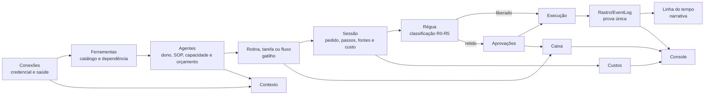

# Varredura dos módulos do ROOT OS — 16/09/2026

## Escopo e método

Esta varredura cobre os 15 itens visíveis na captura de 15/09/2026:

- **A central:** Console, Contexto, Sessões e Caixa;
- **Quem trabalha:** Agentes, Custos, Rotinas, Fluxos e Organograma;
- **O controle:** Aprovações, Régua, Rastro e Linha do tempo;
- **O que existe:** Ferramentas e Conexões.

Foram comparados quatro tipos de evidência:

1. navegação e promessas declaradas em `packages/shared/src/nav.ts`;
2. telas, chamadas de API e estados vazios de `apps/web/src/app`;
3. controladores, serviços e modelos em `apps/api/src` e `apps/api/prisma`;
4. planos e especificações deixados no repositório, especialmente
   `PLANO-CONTINUIDADE.md`, `PLANO-CONTROLE-DE-AGENTES.md` e as especificações A5, A6 e A8.

A suíte web foi executada durante a varredura: **28 arquivos e 382 testes passaram**. O CI completo
do mesmo `HEAD` também está verde. Teste verde comprova o comportamento coberto; não comprova que a
empresa tenha dados, credenciais e configuração para produzir resultado no uso real.

## Diagnóstico executivo

O produto tem mais implementação do que a interface faz parecer. O problema está dividido em
quatro classes:

1. **Rotas sem produto:** Fluxos e Ferramentas chegam ao componente genérico de placeholder. Não há
   tela funcional nesses dois endereços.
2. **Funções sem caminho de configuração:** Custos não permite criar o teto diário da empresa;
   Agentes não permite editar dono e pilar, embora a API já aceite; Rotinas não permite criar uma
   rotina a partir da própria tela.
3. **Peças existentes sem continuidade automática:** tarefa atribuída, menção e aprovação resolvida
   ainda não acordam o agente. A A6 especifica essa fila, mas ainda não foi implementada.
4. **Duas verdades para auditoria:** Rastro lê `AuditLog`; Linha do tempo lê `EventLog`. A navegação
   afirma que as duas são leituras da mesma fonte, mas hoje não são.

Na conferência de produção feita nesta sessão, o estado operacional reforçou essas lacunas:

- 8 agentes, todos sem dono;
- nenhum agente com linha de base e nenhum orçamento mensal ativo;
- 6 agentes sem procedimento completo;
- nenhum teto diário da empresa, portanto nenhum livro-caixa diário confiável;
- nenhuma tarefa atribuída a agente;
- fila de aprovação e `EventLog` vazios.

Esses zeros não provam falha das APIs. Eles mostram que o produto não conduz a empresa pela
configuração mínima nem fecha o ciclo que gera sessões, decisões, eventos e custos.

## Matriz dos módulos

Legenda:

- **Funcional:** tela e API entregam o núcleo prometido;
- **Parcial:** o núcleo existe, mas falta configuração, continuidade ou parte declarada;
- **Divergente:** a tela funciona, porém usa uma fonte incompatível com a promessa atual;
- **Placeholder:** item de menu sem tela de produto.

| Módulo | Estado atual comprovado | O que deveria entregar | Lacuna principal | Conexões necessárias | Avaliação |
|---|---|---|---|---|---|
| **Console** | KPIs de leads, vendas, campanha, tarefa atrasada e pílula de custo | Pulso do OS: atenção imediata, agentes, rotinas, conexões, aprovações, custo e falhas | É principalmente um dashboard de marketing; quase não resume a saúde dos 14 módulos ao redor | Caixa, Agentes, Rotinas, Conexões, Aprovações, Custos e Rastro | **Parcial** |
| **Contexto** | Mapa real de memória, agentes, rotinas, conexões e pessoas; busca textual e semântica; criação de nota e releitura da vault | Ser a visão unificadora da empresa e abrir cada registro real | Marca e Identidade continuam declaradas como futuras; a listagem de memória baixa corpos inteiros e não pagina | Conexões alimentam fontes; Agentes, Rotinas e Organograma dão estrutura; Memória dá conhecimento | **Parcial** |
| **Sessões** | Lista por canal/agente, custo, procedência e traço detalhado; links para Aprovações e Rastro | Explicar do pedido ao resultado, incluindo ferramentas, decisão, fonte e custo | Depende de invocação manual/rotina; sem o heartbeat, muitos eventos do trabalho não geram sessão | Agentes, Régua, Ferramentas, Aprovações, Rastro e Custos | **Funcional** |
| **Caixa** | Agrega aprovações assináveis, tarefas paradas e comentários recentes; estados vazios são explicados | Ser “o que precisa de mim” com contador e ações profundas | Responsabilidade ainda casa por texto; comentário não é menção e não existe estado de lido | Aprovações e Trabalho; A6 para menções e continuidade | **Parcial** |
| **Agentes** | Roster, estado medido/declarado, invocar, pausar, retomar, encerrar, SOP, linha de base, orçamento e link para sessões | Configurar e operar cada agente de ponta a ponta | A API aceita nome, missão, pilar e dono, mas a tela não oferece editor. Sem dono/pilar, o SOP não pode ficar completo | Organograma, Sessões, Custos, Régua, Ferramentas, Rotinas e Trabalho | **Parcial** |
| **Custos** | Relatório por empresa/dia/agente, orçamento mensal e recusas honestas quando o total não é confiável | Medir, alertar e permitir configurar limites antes de cortar gasto | Não existe rota, semente, provisionamento nem tela para criar `TetoDeCustoIa`; sem teto, o livro-caixa diário não nasce | Console, Agentes, Sessões e Rastro | **Parcial crítico** |
| **Rotinas** | Lista, estado, interruptor, execução manual, histórico, diagnóstico do agendador e horas devolvidas | Cadastrar, agendar, acompanhar e recuperar rotinas | Só lista/altera/roda rotinas já registradas; não há criação na própria superfície. O vazio remete à Pauta | Agentes, Sessões, Custos, Conexões e Rastro | **Parcial** |
| **Fluxos** | Rota, permissão, item de menu e mensagem genérica | Mostrar o processo ponta a ponta, gargalos, responsáveis e vazamentos | Não há página, API, modelo ou especificação fechada de editor | Trabalho, Rotinas, Agentes, Aprovações e Rastro | **Placeholder** |
| **Organograma** | Pessoas e agentes agrupados por pilar, com papéis, estado e fallback declarado | Mostrar responsabilidade humana e agentes por pilar | É somente leitura e depende de dono/pilar configurados em Agentes; hoje não há caminho de correção na UI | Agentes e Régua/Usuários | **Funcional, mas bloqueado pela configuração de Agentes** |
| **Aprovações** | Fila por estado, conteúdo exato para decisores, alçada, segunda pessoa, motivo, reautenticação, confirmar/executar e recusar | Fazer qualquer ação retida chegar à pessoa certa e devolver o desfecho ao fluxo | Entrada por WhatsApp continua futura; depois da decisão o agente não é acordado para continuar | Régua, Caixa, Conexões, Sessões, Rastro e A6 | **Funcional no núcleo; parcial no canal e continuidade** |
| **Régua** | Escada R0–R5, sinais, catálogo de capacidades, agentes, sobrescritas, simulador e pessoas autorizadoras | Explicar e simular a política efetiva da empresa | A profundidade técnica chega antes de um resumo operacional; Ferramentas duplica parte desse assunto sem existir | Agentes, Ferramentas, Aprovações e Rastro | **Funcional** |
| **Rastro** | Tabela filtrável do `AuditLog`; API separada verifica cadeia e retenção do `EventLog` | Prova única, encadeada, verificável e correlacionada de tudo que passou pela porta | A listagem visível ainda lê o log administrativo antigo e não mostra a cadeia que a tela promete | Sessões, Régua, Aprovações, Conexões e Linha do tempo | **Divergente crítico** |
| **Linha do tempo** | Narrativa paginada do `EventLog`, agrupada por dia e filtrada por família, agente e tipo | Leitura humana do mesmo fato comprovável no Rastro | O “mesmo fato” ainda não aparece no Rastro visível; sem eventos operacionais, a tela fica legitimamente vazia | Rastro, Sessões e Aprovações | **Funcional** |
| **Ferramentas** | Rota, permissão, item de menu e mensagem genérica | Catálogo das 35 ferramentas MCP, capacidades disponíveis, risco, agente que declarou e conector exigido | Não há página; “ferramenta MCP” e “capacidade da porta” ainda não têm uma apresentação única | Régua, Agentes, Sessões e Conexões | **Placeholder** |
| **Conexões** | Catálogo dinâmico, saúde sondada, status, autorizar, sincronizar, revogar, desligar/religar e ClickUp | Dizer se cada fonte está pronta agora e o impacto de uma falha | Falta ligar visualmente cada conector às ferramentas, agentes, rotinas e módulos que dependem dele; Google OAuth segue como bloqueio externo conhecido | Contexto, Ferramentas, Rotinas, Aprovações e Agentes | **Funcional** |

## O fluxo que o produto precisa fechar

O desenho correto já está quase todo no repositório:

Hoje o fluxo quebra em quatro pontos:

1. **Conexões → Ferramentas:** não há tela de Ferramentas nem mapa de dependência;
2. **Agentes → Gatilho:** tarefa atribuída, menção e decisão de aprovação não acordam o agente;
3. **Configuração → Operação:** dono/pilar e teto diário não podem ser configurados pelas telas;
4. **Execução → Prova:** Linha do tempo lê `EventLog`, mas Rastro continua mostrando `AuditLog`.

## Estrutura de navegação recomendada

As quatro seções atuais são compreensíveis. A confusão vem de itens irmãos que são, na prática,
leituras do mesmo objeto. A estrutura pode ficar mais curta sem apagar funcionalidade:

### A central

- **Console:** saúde do OS e exceções;
- **Contexto:** mapa da empresa;
- **Caixa:** o que requer a pessoa;
- **Sessões:** histórico de conversas e execuções.

### Quem trabalha

- **Agentes**, com abas ou subitens **Visão**, **Custos** e **Organograma**;
- **Rotinas**;
- **Fluxos**, apenas depois de existir um contrato funcional claro.

### O controle

- **Aprovações**;
- **Régua**;
- **Rastro**, com abas **Linha do tempo**, **Prova**, **Integridade** e **Retenção**.

### O que existe

- **Ferramentas**, com catálogo, risco, agentes e dependências;
- **Conexões**, com credencial, saúde e ações operacionais.

Isso transforma Custos, Organograma e Linha do tempo em leituras contextualizadas, mantendo URLs e
permissões existentes. Fluxos e Ferramentas não devem continuar parecendo entregues enquanto caem no
placeholder.

## Ordem recomendada de correção

### P0 — tornar o que já existe utilizável e verdadeiro

1. **Unificar Rastro e Linha do tempo em `EventLog`.** A tela de Rastro deve listar a prova
   encadeada, chamar a verificação de integridade e mostrar retenção. O `AuditLog` pode sobreviver
   como “auditoria administrativa”, com nome explícito, durante a transição.
2. **Criar configuração de custo da empresa.** Adicionar API e UI para teto diário, fuso, modo de
   observação/imposição e responsável/motivo. O livro-caixa deve registrar gasto mesmo antes de um
   teto ser imposto.
3. **Ligar o editor de identidade de Agentes.** Usar o `PATCH /agents/:slug` já existente para
   editar dono, pilar, nome e missão. A própria tela deve conduzir os 8 agentes até o procedimento
   completo.
4. **Parar de anunciar placeholders como módulos disponíveis.** Ocultar Fluxos até o contrato ser
   decidido. Ferramentas pode ser entregue rapidamente porque os catálogos já existem.

### P1 — fechar o ciclo operacional

5. **Implementar a A6 em fatias seguras:** atribuição de tarefa e resolução de aprovação primeiro;
   menção depois. Cada gatilho deve gerar sessão, respeitar custo/régua e continuar no mesmo
   `correlationId`.
6. **Dar um caminho de nascimento às Rotinas.** Se o produto aceitar apenas rotinas conhecidas,
   oferecer modelos e apontar a origem. Se aceitar composição, definir o contrato antes de criar um
   editor genérico.
7. **Construir Ferramentas a partir de fonte única.** Cada linha deve responder: o que faz, leitura
   ou escrita, nível de risco, quais agentes declararam, qual conector exige e se está disponível.

### P2 — reduzir confusão e tornar o Console operacional

8. **Transformar o Console em resumo dos módulos:** pendências da Caixa, agentes sem dono/SOP,
   rotina em erro, conexão degradada, aprovação vencendo, gasto/teto e integridade do Rastro.
9. **Ligar os estados vazios ao conserto.** “Sem dono” abre edição; “sem teto” abre configuração;
   “sem rotina” abre modelos; “conector indisponível” abre Conexões já filtrado.
10. **Compartilhar filtros e correlação.** Uma sessão deve abrir sua aprovação, custo e eventos; um
    evento deve voltar à sessão/agente/tarefa que o originou.

### P3 — produto avançado, depois do ciclo básico medido

11. **A5 — meta da empresa e linhagem:** toda tarefa explica por que existe.
12. **A8 — delegação e contratação:** agente propõe plano, pessoa aprova, tarefas mantêm a linhagem.
13. **Fluxos:** construir como visualização da linhagem e das passagens reais, evitando um segundo
    modelo de processo desconectado de Trabalho, Rotinas e Rastro.

## Critério de “100% funcional” para esta frente

Os módulos da captura podem ser considerados funcionais quando um usuário administrador conseguir,
sem banco, terminal ou intervenção do desenvolvedor:

1. conectar uma fonte e verificar sua saúde;
2. ver quais ferramentas essa conexão habilita;
3. atribuir dono/pilar, completar SOP, linha de base e orçamento de um agente;
4. configurar o teto diário da empresa;
5. criar ou ativar um gatilho suportado;
6. observar o gatilho gerar uma sessão;
7. ver a Régua liberar ou reter uma ação;
8. decidir a ação na Caixa/Aprovações e o agente continuar;
9. conferir o custo da passagem;
10. localizar o mesmo fato na Linha do tempo e provar sua integridade no Rastro;
11. receber no Console qualquer falha desse percurso com link direto para o conserto.

Enquanto esse cenário não passar de ponta a ponta, uma coleção de páginas individualmente verdes
continuará parecendo um conjunto confuso e pouco funcional.

## Evidência e confiança

- **Alta confiança:** placeholders de Fluxos/Ferramentas; ausência de configuração do teto; UI sem
  edição de dono/pilar; fontes diferentes entre Rastro e Linha do tempo; A6 apenas especificada.
- **Alta confiança:** funcionalidades descritas na matriz, porque foram lidas nas páginas,
  controladores e serviços e a suíte web passou integralmente.
- **Média confiança:** prioridade relativa entre A5, A6 e A8. A6 é necessária para continuidade; A5
  e A8 dependem de decisões de produto registradas e não devem ser implementadas por inferência.
- **Média confiança:** saúde de cada fornecedor externo em produção. A tela e o contrato existem,
  mas OAuth, credenciais e disponibilidade dependem do ambiente e devem ser sondados separadamente.
